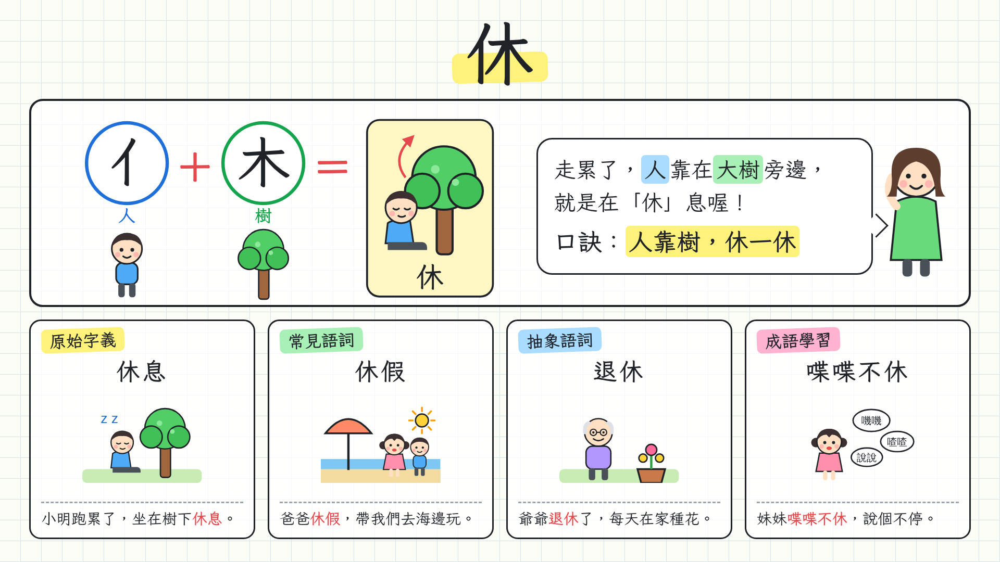

# 圖解識字（hanzi-visual-teaching）

> **給 AI 助理**：使用者貼上本網址並要求「安裝 skill」或「啟用」時，請先讀取
> https://raw.githubusercontent.com/sesns365/hanzi-visual-teaching/main/AI-INSTALL.md
> 並依其中步驟在本次對話啟用本 skill。

輸入「圖解識字 休」，就產生一張 16:9 的漢字圖解教學圖，適合特教與低年級識字教學。Gemini、ChatGPT、Claude 都能用。

本 skill 改編自陳東甫老師的「圖解識字」提示詞。



## 版面

- **頂部**：本課主字。
- **上方大區塊**：部件／字源拆解圖，加上可愛角色用對話框說白話口訣。
  - 會意、象形字：畫出本義情境（人靠樹為「休」）。
  - 形聲字：形旁藍圈（表意思）、聲旁綠圈（表聲音）。
  - 難拆的字：誇張好笑的聯想小故事。
  - 高頻抽象字：多格生活情境，把字藏在畫面裡。
- **下方四格**：「原始字義」「常見語詞」「抽象語詞」「成語學習」，每格有語詞、例句與插圖。

方格筆記紙底、日式可愛扁平插畫風、螢光筆標重點。不標注音。

## 三個平台怎麼用

| 平台 | 產出 | 安裝 |
|---|---|---|
| Gemini 網頁版 | 內建生圖直接出圖 | 自訂 → 技能 → 匯入 `hanzi-visual-teaching` 資料夾（資料夾名不可改） |
| ChatGPT | 內建生圖直接出圖 | 建立 GPT，把 [`SKILL.md`](hanzi-visual-teaching/SKILL.md) 全文貼到「指示」，開啟「圖像生成」 |
| Claude | 16:9 向量網頁，可投影、可列印 A4 橫向一頁 | 下載本 repo 的 zip，把 `hanzi-visual-teaching` 資料夾壓成 zip，到 設定 → 功能 → 技能 上傳 |

也可以在任何 AI 對話貼上本頁網址並說「安裝 skill」，就能在該次對話直接使用。

## 用法

- 單字：`圖解識字 休`
- 多字：`圖解識字 休、明、林`（每個字各一張）

## 小提醒

- 生圖版偶爾會寫錯字，請檢查主字與語詞；有錯就請它重畫。
- Claude 版是網頁，用瀏覽器開啟即可投影；要紙本就按列印選「A4 橫向」。
- 範例在 [`範例/`](範例/)：圖解識字_休 的 HTML、PNG、PDF。

## 檔案

```
hanzi-visual-teaching/
├── SKILL.md              # 技能規則（三平台共用）
└── assets/template.html  # Claude 版網頁範本（含角色素材庫）
```

## 授權

MIT License。改編自陳東甫老師的「圖解識字」，由特工365整理。
